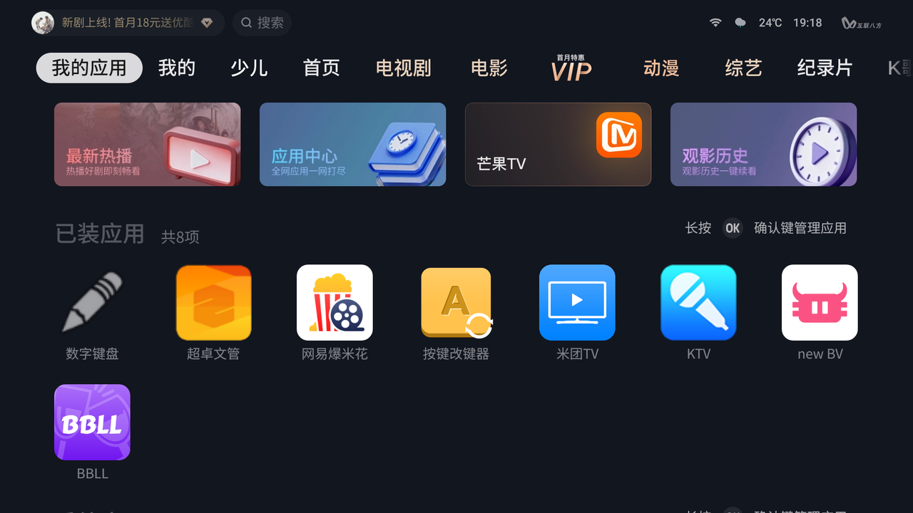
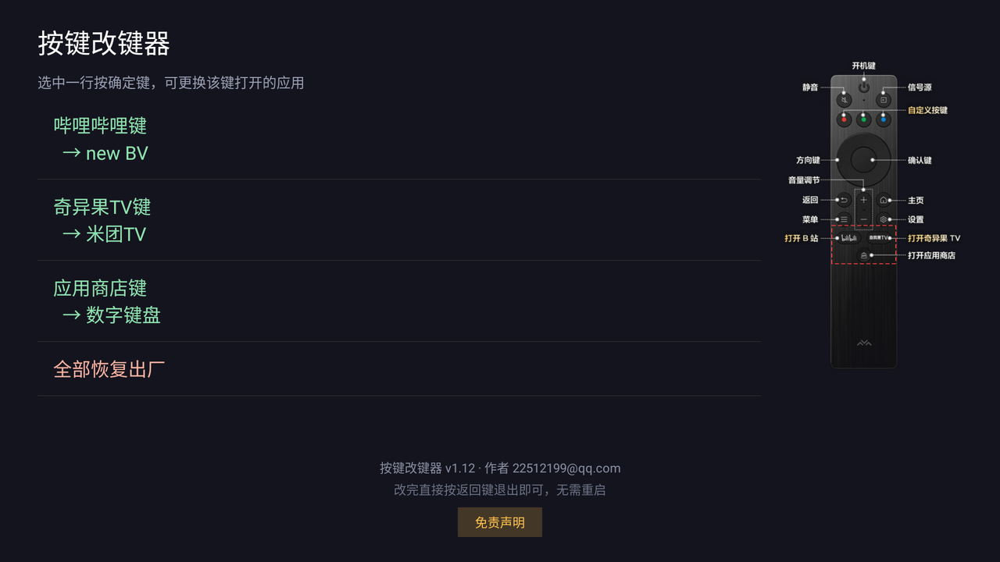
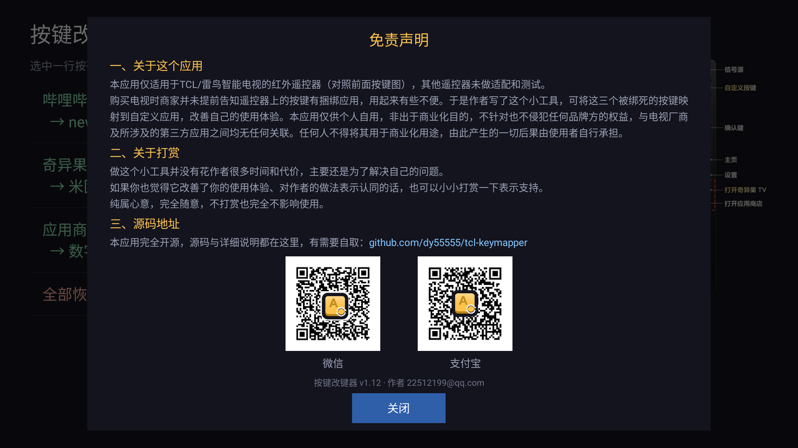

# 按键改键器

把遥控器上那几个「按下去只能开厂家指定应用」的专用键，改成打开任意应用。


包名 `com.tclhotkey.redirect` · 版本 **1.13** · 需要 Android 5.0+
**不用 root，不用刷机**，走标准 Android 无障碍服务（AccessibilityService）拦按键。

---

## 它是干嘛的

买电视的时候商家一般不会告诉你：遥控器上那三个花花绿绿的键是**绑死的**。

| 遥控器上印的 | 按下去只能开 |
|---|---|
| 哔哩哔哩 | 云视听小电视 |
| 奇异果TV | 奇异果TV |
| 应用商店 | 电视自带应用商店 |

用不上这些的人，这三个键就等于废了 —— 想改成开自己的播放器、KTV、米团TV？
系统设置里没有这个选项。

这个工具做的事：**把这三个键重新指向你指定的任意应用**。

装完之后，电视桌面多一个图标：



> **配套应用：[数字键盘](https://github.com/dy55555/tcl-numberpad)**
>
> 很多电视遥控器上**一个数字键都没有**，想跳到 12 台只能一页页往上翻。
> 那个仓库做了块悬浮数字键盘，但它不能独立启动 ——
> **正是要靠这个改键器，把上面三个键里的某一个绑到它**，
> 按那个键就把数字键盘呼出来了。两个项目是一套的。

---

## 主界面



选中一行按**确定键**，从已安装应用列表里挑一个就行。
改完直接按返回键退出，**不用重启电视**。

底部「全部恢复出厂」一键把三个键都还给原厂行为。
作者信息旁边那行是使用提示，下面的「免责声明」按钮里有完整的说明和作者的收款码：



---

## 三个键的按键码

默认针对 **TCL / 雷鸟** 遥控器上这三个键：

| 键 | keyCode | 原厂行为 |
|---|---|---|
| 哔哩哔哩键 | `4171` | 开云视听小电视 |
| 奇异果TV键 | `4176` | 开奇异果TV |
| 应用商店键 | `4168` | 开应用商店 |

**换成别的遥控器时**，改 `java/com/tclhotkey/redirect/Config.java` 里的
`KEYS` 数组和 `KEY_NAMES` 即可。

怎么知道自己遥控器的按键码：先把无障碍服务打开，按一下那个键，用 `adb logcat`
看有没有对应输出；或者临时在 `RedirectAccessibilityService.onKeyEvent()` 里
把 `event.getKeyCode()` 打出来。

---

## 安装

### 1. 装 APK

编译好的安装包就在本仓库里：

| 文件 | 说明 |
|---|---|
| [`tools/按键改键器.apk`](tools/) | 当前版本 1.13，与本仓库源码同源构建（已在电视上实测安装通过） |

> 在 GitHub 文件页右上角点 **Download**（或点 **Raw**）即可下载。

#### 办法一：一键脚本（推荐）

`tools/` 里带了一个 [`一键安装到电视.bat`](tools/一键安装到电视.bat)：

1. **双击它**（或者把 APK 拖到它上面松手）；
2. 输入电视的 IP，回车；
3. 等十几秒，看到「装好了」。

电视和电脑要在同一个 WiFi 里，电视的 ADB 开关要开着（见下面第 2 节）。

> 脚本自己会去找 `adb.exe`：先看自己所在目录，再看系统 PATH，
> 最后翻几个常见的 SDK 安装位置。都没有的话会告诉你去哪儿弄一个。
> 第一次输的 IP 会记在 `tools/.tv-ip.txt` 里，以后直接回车就行。

#### 办法二：U 盘 + 电视界面（不想碰电脑的话）

- **U 盘 + 电视自带的文件管理器**；
- 「应用市场 → 我的 → U 盘安装」这类入口；
- TCL / 雷鸟电视：**【安全卫士】→【应用管理】→【应用安装】**。

#### 为什么 `adb install` 会报 `INSTALL_FAILED_VERIFICATION_FAILURE`？

TCL 固件在安装链路上加了一道**必需校验器**（Required Verifier），
对 shell（也就是 adb 用的那个身份）提交的安装一律拒绝。
**这不是包的问题** —— 换任何一个别的包、乃至应用商店自己下载的包，
走这条命令一样失败。

拦截点就是 `com.android.packageinstaller` 这个包，见下面「[用 adb 装 / 调试](#用-adb-装--调试)」一节。

### 2. 开无障碍服务

两种方式，**任选一种**：

**方式 A —— 电视上手动开（不想碰电脑的话）**

设置 → 无障碍 → 找到「按键改键器」→ 打开。

**方式 B —— 电脑上一键开（推荐）**

用 [`tools/一键开启无障碍.bat`](tools/)，双击就行。它会做三件事：

1. `adb connect <电视IP>:5555` 连上电视；
2. `pm grant` 授予 `WRITE_SECURE_SETTINGS`（让应用以后能自己维护服务状态）；
3. 拉起 `LaunchActivity` 把服务写进系统启用列表。

> 用这个 bat 需要你自己准备一个 `adb.exe`（Android SDK 的 platform-tools），
> 放在同一个目录下；电视要先在「设置 → 关于 → 版本号」连点七下打开开发者选项、
> 再打开「USB 调试 / 网络调试」，电脑和电视在同一个局域网里。
> 脚本里电视 IP 默认是 `192.168.1.100`（占位值），第一次跑会问你要电视的实际 IP。

---

## 它是怎么工作的

两个关键词：**无障碍服务** + **拦截特定 keyCode**。

```
你按遥控器上的「哔哩哔哩键」
  → Android 系统把它派发给所有已启用的无障碍服务
  → 本应用在 onKeyEvent() 里看到 keyCode == 4171
  → 回一个 true，把这颗按键「吃掉」，厂家原来的行为就不会发生
  → 读配置（SharedPreferences）：这个键被指到了哪个应用？
  → startActivity() 把它拉起来
  → 完事
```

因为走的是**标准无障碍 API**，所以：

- 不需要 root；
- 不需要 adb 常驻（第 2 步那种授权只做一次，之后拔了电脑也照样用）；
- 理论上任何 Android 5.0+ 的机器都能跑，只是按键码要按你的遥控器改。

---

## 两个必须知道的坑

### 坑 1：别对它用「强制停止」

`am force-stop`（或者在系统设置里点「强制停止」）会让无障碍服务**从系统的启用列表里被摘掉**。

这是 Android 的保护机制 —— 包被整体停掉了，之前那份授权就不再信任。
需要在电脑上重新跑一次 `tools/一键开启无障碍.bat` 才能恢复。

正常使用是不会碰到的，**别手贱去点它就行**。

### 坑 2：更新 APK 之后要「唤醒」一次

同样的原因：**覆盖安装也会让无障碍服务掉线**（包内容变了，系统要你重新确认）。

恢复方式，二选一：

- 电脑上跑一次 `tools/一键开启无障碍.bat`；
- **从电视桌面正常打开一次改键器**。

第二种能成立是因为 `MainActivity.onCreate()` 里也会调用 `ServiceEnable.tryEnable()`。
早先的版本只有 `LaunchActivity` 会去写系统设置，主界面只读不写，所以「打开一次改键器」
其实没任何用 —— 必须重启电视（靠 `BootReceiver` 拉起 `LaunchActivity`）或者在电脑上跑 bat。
现在主界面自己也会写，从桌面点一次就恢复。

> 上面两条的前提是 `WRITE_SECURE_SETTINGS` **被授予过**（也就是第 2 步走过一次）。
> 没授权的话 `tryEnable()` 会静默失败，主界面底部会显示一条橙色的
> 「按键服务还没开启」提示条 —— 看到它就去跑 bat。

**不处理会怎样**：重启电视也会自动恢复（`BootReceiver` 收到开机广播会拉起 `LaunchActivity`）。

---

## 源码

9 个 Java 文件，全在 `java/com/tclhotkey/redirect/`：

| 文件 | 作用 |
|---|---|
| `Config.java` | 按键码、目标应用的读写（SharedPreferences） |
| `MainActivity.java` | 主界面：三行列表 + 全部恢复出厂 + 底部作者信息/免责声明入口 |
| `AppPickerActivity.java` | 选应用：列出所有已安装且可启动的应用 |
| `RedirectAccessibilityService.java` | **核心**：拦截按键、启动目标应用 |
| `ServiceEnable.java` | 无障碍服务的开关状态查询与自动开启 |
| `LaunchActivity.java` | 透明 Activity，解除 stopped 状态并自愈式开启服务 |
| `BootReceiver.java` | 开机 / 应用更新后拉起 `LaunchActivity` |
| `SetTargetActivity.java` | 供 adb 调用的免重装改目标入口 |
| `DisclaimerDialog.java` | 免责声明弹窗（三段文案 + 两张收款码） |

资源：

- `res/mipmap-*/ic_launcher.png` —— 五档应用图标（512 设计稿缩到 mdpi 108 / hdpi 160 /
  xhdpi 216 / xxhdpi 324 / xxxhdpi 432）。给 hdpi 直接上 160px 是因为
  240dpi 的电视桌面图标盒子就是 160px，这样能 1:1 原样绘制，不会被最近邻放大出马赛克；
  图标由 [`tools/make-icon.py`](tools/make-icon.py) 生成（`python tools/make-icon.py`
  一条命令重画五档，运行时自检"转换圈箭头与圆弧同轴"和"四角透明"）；
- `res/drawable/remote.png` —— 主界面右侧那张遥控器示意图；
- `res/drawable/qr_*.png` —— 免责声明里的收款码。

---

## 用 adb 装 / 调试

不想用 U 盘的话，这里有两条命令能用。

### 装（绕过电视的安装校验）

电视上常见的拦截来自一个叫 `com.android.packageinstaller` 的 Required Verifier。
临时把它停掉，装完再恢复：

```bash
adb shell pm disable-user --user 0 com.android.packageinstaller
adb install -r -g 按键改键器.apk
adb shell pm enable com.android.packageinstaller
```

> `-g` 是顺手把清单里声明的普通权限都授了。
> 中间那步失败也要把第三条执行掉，别留在禁用状态。

**在 TCL 电视（Android 11 / MT9653）上的实测结论**：

| 做法 | 结果 |
|---|---|
| 直接 `adb install` / `pm install` 的各种变体 | 一律 `INSTALL_FAILED_VERIFICATION_FAILURE` |
| `appops set --uid com.android.shell REQUEST_INSTALL_PACKAGES allow` | 无效（设置成功但过程序不认） |
| `pm grant com.android.shell REQUEST_INSTALL_PACKAGES` | `SecurityException`（shell 没申请过这个权限） |
| **先 `pm disable-user` 停掉校验器，再装** | **两条路都 `Success`** ✅ |
| 停掉之后 `pm install` 本地文件路径 | 也 `Success` ✅ |

所以拦截点确实就是这一个包，把它让开就通了。
（恢复后再查 `pm list packages -d` 是空的，包管理器状态正常。）

`tools/一键安装到电视.bat` 就是这三步的封装，并且无论安装成功还是失败都会执行恢复。

### 其他常用入口

```bash
# 开服务（等价于 bat 的第 2、3 步）
adb shell pm grant com.tclhotkey.redirect android.permission.WRITE_SECURE_SETTINGS
adb shell am start -n com.tclhotkey.redirect/com.tclhotkey.redirect.LaunchActivity

# 查服务当前状态
adb shell settings get secure enabled_accessibility_services

# 不重装直接改目标（key 取 4171 / 4176 / 4168 之一）
adb shell am start -a com.tclhotkey.redirect.SET_TARGET \
  --es key 4171 --es pkg dev.frost819.newbv
```

> **提醒**：用 `adb shell input keyevent` 测这三个键是**测不出来**的 ——
> 那条通路走的是 TCL 原厂中间件，绕过了无障碍过滤器。
> 真要验证，拿物理遥控器按。

---

## 自己编译

不依赖 Gradle，也不需要完整的 Android SDK：

```bash
./build.sh
# 产物：build/app.apk
```

脚本自己会做的事：

```
源码搬到纯 ASCII 临时目录
  → aapt2 编译资源
  → aapt2 link 出 base.apk，同时生成 R.java
  → ECJ 编译 java（含 R.java）→ .class
  → d8 把 .class 转成 classes.dex
  → 把 dex 塞回 APK
  → apksigner 签名
```

**为什么要先搬到临时目录**：`aapt2` / `apksigner` 是 Windows 程序，路径里带中文就直接报
`failed to open directory: 系统找不到指定的文件`。所以这棵源码树可以放在任何位置
（哪怕目录名是中文），脚本会自己搬到一个纯 ASCII 的临时目录去编。

### 工具链

需要 5 个文件，它们**都不随本仓库分发**（体积大 + 各有各的授权协议）：

| 文件 | 是什么 | 从哪来 |
|---|---|---|
| `aapt2.exe` | 资源编译器 | Android SDK 的 `build-tools/<版本>/` |
| `d8.jar` | class → dex | Android SDK 的 `build-tools/<版本>/lib/` |
| `apksigner.jar` | APK 签名 | Android SDK 的 `build-tools/<版本>/lib/` |
| `android.jar` | 编译期的 Android 平台库 | Android SDK 的 `platforms/android-<API>/` |
| `ecj-3.26.0.jar` | Eclipse Java 编译器 | <https://repo1.maven.org/maven2/org/eclipse/jdt/ecj/> |

**已经有 Android SDK 的话什么都不用准备**，让脚本能找到就行：

```bash
export ANDROID_SDK=/path/to/Android/Sdk
./build.sh
```

否则就在仓库根建一个 `toolchain/` 目录，把上面 5 个文件扁平放进去，脚本会自己按名字找
（这个目录已在 .gitignore 里，不会进仓库）。

单独指定某一件用环境变量，按上面表格里的名字：

```bash
JAVA=/path/to/java ECJ=/path/to/ecj.jar ./build.sh
```

可用的环境变量：`ANDROID_SDK` `ANDROID_PLATFORM` `JAVA` `JAVA_HOME`
`AAPT2` `D8JAR` `APKSIGNER` `ANDROIDJAR` `ECJ`

> **关于 ecj**：用它而不是 `javac`，是因为 `javac` 从 JDK 9 起就不再支持
> `-bootclasspath` 了，而编译 Android 的 class 必须把 `android.jar` 当 bootclasspath 用。
> `ecj` 一直支持，而且单独一个 jar、只需要 JRE 就能跑。

> **关于签名**：仓库里带了一份 `debug.keystore`（**调试用，密码就是 `android`**，
> 别名 `hotkey`，这是 Android 生态的通行约定）。想用自己的密钥就替换它，
> 同时改 `build.sh` 底部那几行。**要正式分发的话请另外生成一把发布密钥**，
> 别拿调试密钥当发布密钥用。

---

## 常见问题

**装好了 / 更新之后，改的键不生效，重启电视才生效？**
不是 bug，是 Android 的机制，见上面「两个必须知道的坑」。

**主界面底部有一条橙色的警告条？**
说明无障碍服务没开起来，或者 `WRITE_SECURE_SETTINGS` 没授过。跑一次
`tools/一键开启无障碍.bat`。

**能改成开机自启的应用吗？**
能，选应用列表里所有可启动的应用都在里面。

**支持非 TCL 的电视吗？**
走的是标准无障碍 API，通用性理论上没问题，但**按键码必须按你的遥控器改**
（见「三个键的按键码」一节）。作者手上只有 75R69A（Android 11）实测过。

---

### ⚠️ 关于收款码

仓库里 `res/drawable/qr_wechat.png` 和 `res/drawable/qr_alipay.png` 放的是**网上公开的示例码**，
不是某个人的真实收款码（实测解码：微信那张是 `wxp://…` 演示串，
支付宝那张是 `https://qr.alipay.com/fkx10208fh4wdhbovzfjla2` 官方文档里的演示码）。

也就是说：**现在打赏会打给演示码对应的那个演示收款账户**，别指望能收到钱。

要用自己的：把两张图换成自己生成的收款码，文件名保持不变，重新 `./build.sh` 即可，
不用改任何代码。放不进去的话，声明页会自动降级成一行提示文字，不会崩。

---

## 授权与声明

- 代码以 **MIT 许可证** 发布，见 [LICENSE](LICENSE)。
- 本应用**仅适用于 TCL / 雷鸟智能电视的红外遥控器**，其他遥控器未做适配和测试。
- 本项目是**个人自用工具**，**非商业化目的**，与任何电视/机顶盒品牌方**没有关联**，
  也未获得其授权或赞助；请勿将本项目用于商业用途。
- 项目里出现的应用名、商标、图标等归各自权利人所有，此处仅用于说明兼容性和操作路径。
- 本软件按「现状」提供，**不提供任何担保**。改键操作由你自己承担风险。

作者：`22512199@qq.com`

---

如果这个小工具恰好也解决了你的问题，欢迎点个 Star。
